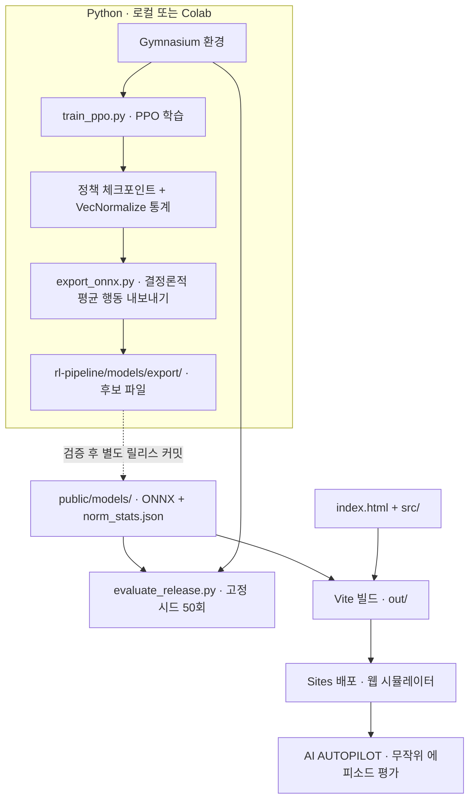
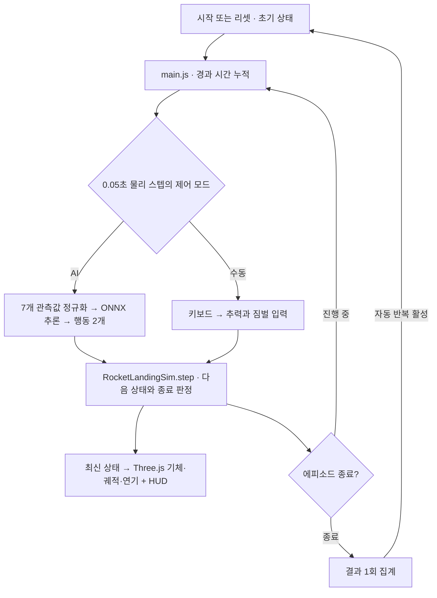

# Virtual Launch Lab 개발 파이프라인

브라우저에서 **AI AUTOPILOT**을 누르면 저장소에 포함된 정책을 내려받아 추론한다. 모델을 학습하는 Python 프로세스, 모델을 배포하는 Vite 빌드, 매 순간 기체 상태를 계산하는 웹 앱은 각각 독립적으로 실행된다.

## 모델은 어디서 만들어지고 어디서 쓰이나?



점선은 사람이 수행하는 릴리스 작업이다. 내보내기 명령은 후보 파일을 별도 디렉터리에 쓴다. 버전 18에서 검증한 파일은 커밋 `904bcee`의 모델과 통계 한 쌍이다. 현재 학습 스크립트에는 기본 PPO 학습 설정이 들어 있으며, 해당 릴리스를 학습한 원본 체크포인트는 저장소에 없다. [학습 코드](../rl-pipeline/train_ppo.py) · [내보내기](../rl-pipeline/export_onnx.py) · [검증된 파일의 SHA-256](../public/models/README.md)

## 한 에피소드는 어떻게 실행되나?



`main.js`는 렌더 프레임마다 경과 시간을 누적하고 진행 중인 추론이 끝난 뒤 다음 물리 스텝을 실행한다. 화면은 최신 상태를 모니터 주사율에 맞춰 그린다. AI를 처음 선택하면 컨트롤러가 파일 두 개를 읽고 ONNX 세션을 만든다. 이후 같은 페이지에서는 세션을 재사용한다. 자동 반복은 모델 가중치를 유지하며 새로운 초기 조건에서 성공률을 측정한다. [실행 루프](../src/main.js) · [AI 입력·출력](../src/ai/RocketRLController.js) · [웹 물리](../src/simulation/RocketLandingSim.js)

## 코드를 읽을 때의 출발점

| 확인할 질문 | 파일과 연결 관계 |
|---|---|
| 어떤 물리를 비교하는가? | [공통 설정](../shared/physics_config.json)을 [Python 환경](../rl-pipeline/env/rocket_landing_env.py)과 웹 앱이 읽는다. 두 구현은 위치·속도·자세·각속도·잔여 연료를 갱신한다. |
| 무엇이 화면에 표시되는가? | [scene](../src/scene)은 기체, 궤적, 배기 입자를 그린다. [TelemetryHUD](../src/ui/TelemetryHUD.js)는 모드·계측·종료 결과를 표시하고 조작 이벤트를 메인 앱으로 전달한다. |
| 무엇을 테스트하는가? | `npm test`는 [웹 모듈 테스트](../tests/web-sim.test.js)와 [이전 실험 테스트 실행기](../tools/test-legacy.cjs)를 호출한다. [릴리스 평가](../rl-pipeline/evaluate_release.py)는 별도 명령으로 실제 배포 모델을 실행한다. |
| 예전 발사·단분리 화면은 어디에 있는가? | [dist](../dist/)에 초기 발사 시뮬레이션, 아케이드, 기록 재생기가 있고 [physics](../physics/)와 [experiments](../experiments/)에는 강체 실험이 있다. 현재 Vite 빌드 출력 경로는 [설정](../vite.config.js)에 지정된 `out/`이다. |
| 이름이 같은 Python 환경은 무엇인가? | 루트의 [env](../env/), [train_rl.py](../train_rl.py), [evaluate_rl.py](../evaluate_rl.py)는 이전 Python 실험이다. 웹과 수치를 대조할 때는 `rl-pipeline/env/`를 사용한다. |

## 평가 결과를 재현하려면

저장소 루트에서 다음 명령으로 릴리스 모델을 읽어 독립 실행할 수 있다.

```sh
python -m pip install -r rl-pipeline/requirements.txt
python rl-pipeline/evaluate_release.py
```

버전 18에서 Python 평가는 시드 1000~1049로 50/50, 배포된 브라우저 평가는 무작위 하강 50회에서 50/50이었다. 두 평가는 서로 다른 초기 조건을 사용한다. 웹 실행과 빌드 명령은 [프로젝트 README](../README.md)에 있다.
